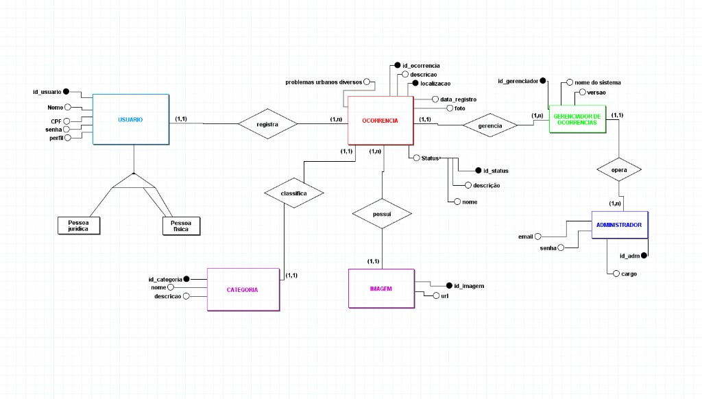

# Inovarc

Sistema de gestão de problemas urbanos. O cidadão registra uma ocorrência, com descrição, local e foto. O administrador acompanha essas ocorrências no painel e muda o status.

Hoje o site é HTML, CSS e JavaScript e abre no navegador, sem servidor. O banco de dados ainda não está criado. O modelo conceitual abaixo é o que será implementado.



## O que mudou no site:

- A entrada do site ficou em `index.html`, que abre a tela de acesso.
- Imagens, CSS e JavaScript foram para `assets/`.
- Cada tela ficou em `paginas/`, com o próprio `index.html`.
- A tela de acesso liga o login do administrador ao painel. O botão Voltar do painel volta para essa tela.
- O cabeçalho do painel foi colocado dentro do `body`, e um fechamento de `div` que sobrava no card de pendentes foi removido.
- As telas que ainda estão em desenvolvimento foram mantidas: home, portal, login e a página de serviços.

`assets/js/login.js` atende só a tela de acesso. `assets/js/logar.js` atende o formulário de `paginas/login`. Os dois não foram unidos para uma tela não usar a função da outra.

## Como abrir

Abra `index.html`. Para ver uma tela isolada, abra o `index.html` da pasta dela.

```
index.html
paginas/
  acesso/index.html       escolha entre cidadão e administrador, com login
  painel/index.html       painel de ocorrências
  home/index.html         tela inicial em desenvolvimento
  portal/index.html       outra versão da escolha, em desenvolvimento
  login/index.html        login separado, em desenvolvimento
  login/servicos.html     destino provisório desse login
assets/
  css/                    estilo de cada tela
  img/                    logo, fundo e ícones
  js/login.js             script da tela de acesso
  js/logar.js             script do login separado
docs/
  modelo-er.png           modelo conceitual do banco
```

## Telas e o que cada uma faz hoje

### Acesso

`paginas/acesso/index.html`, estilo em `assets/css/acesso.css`.

Dois cards abrem o formulário correspondente.

- Cidadão: e-mail e senha. Com os campos preenchidos, a tela avisa que o acompanhamento é pelo aplicativo. A página web do cidadão ainda não existe.
- Administrador: CNPJ e senha. Com os campos preenchidos, abre o painel.
- Voltar fecha o formulário e mostra os cards outra vez.

"Esqueci minha senha" e "cadastre-se" ainda não têm destino.

### Painel

`paginas/painel/index.html`, estilo em `assets/css/painel.css`.

Mostra totais por status e uma tabela de ocorrências. Busca, filtro, números e linhas estão fixos no HTML. Não vêm do login nem de um banco. "Ver detalhes" ainda não abre outra página. Voltar retorna à tela de acesso.

### Telas em desenvolvimento

- `paginas/home/index.html`: mesma escolha da entrada. Os dois cards apontam para `cadastro.html`, arquivo que ainda não existe.
- `paginas/portal/index.html`: os dois cards abrem o mesmo login.
- `paginas/login/index.html`: entra com usuário `admin` e senha `123456` e abre `servicos.html`. Outro dado mostra erro. A senha está no JavaScript só para testar a navegação.
- `paginas/login/servicos.html`: exibe "entrei". É o espaço da futura tela de serviços.

## Banco de dados que será implementado

O desenho é um modelo entidade-relacionamento. A cardinalidade ao lado de cada entidade indica quantas vezes ela participa daquele relacionamento.

### Entidades

**USUARIO** registra a ocorrência. Atributos: `id_usuario`, `Nome`, `CPF`, `senha` e `perfil`. Se especializa em **Pessoa física** e **Pessoa jurídica**. Os subtipos ainda não têm atributos próprios.

**OCORRENCIA** é o problema urbano. Atributos: `id_ocorrencia`, `descricao`, `localizacao`, `data_registro` e `Foto`. O atributo `Status` é composto, com `id_status`, `descrição` e `nome`.

**CATEGORIA** classifica a ocorrência. Atributos: `id_categoria`, `nome` e `descricao`.

**IMAGEM** guarda o arquivo da ocorrência. Atributos: `id_imagem` e `url`.

**GERENCIADOR DE OCORRENCIAS** é o sistema, não uma pessoa. Atributos: `id_gerenciador`, `nome do sistema` e `versao`.

**ADMINISTRADOR** opera esse sistema. Atributos: `id_adm`, `email`, `senha` e `cargo`.

### Relacionamentos

| Relacionamento | Participação | Leitura do desenho |
|---|---|---|
| registra | USUARIO (1,1) e OCORRENCIA (1,n) | cada usuário registra uma ocorrência; cada ocorrência pode ser registrada por vários usuários |
| classifica | OCORRENCIA (1,1) e CATEGORIA (1,1) | uma ocorrência tem uma categoria, e uma categoria classifica uma ocorrência |
| possui | OCORRENCIA (1,n) e IMAGEM (1,1) | uma ocorrência tem várias imagens; cada imagem pertence a uma ocorrência |
| gerencia | OCORRENCIA (1,1) e GERENCIADOR (1,n) | cada ocorrência é gerenciada por um gerenciador; o gerenciador trata várias ocorrências |
| opera | GERENCIADOR (1,1) e ADMINISTRADOR (1,n) | cada gerenciador é operado por vários administradores; cada administrador opera um gerenciador |

O relacionamento `registra` também tem o atributo `problemas urbanos diversos`.

### Tabelas previstas

Na passagem para o banco relacional, cada entidade vira tabela. O identificador com bolinha preenchida vira chave primária. O lado (1,1) de um relacionamento recebe a chave estrangeira do outro lado.

- `usuario`: dados do cidadão, com uma coluna para dizer se é pessoa física ou jurídica.
- `administrador`: login do painel, separado do cidadão.
- `gerenciador`: o sistema que o administrador opera. A ocorrência guarda o `id_gerenciador`.
- `categoria`: tipos de problema, como buraco, iluminação e lixo.
- `status`: sai do atributo composto de ocorrência, porque tem identificador próprio e o mesmo status vale para várias linhas. A ocorrência guarda o `id_status`.
- `ocorrencia`: descrição, localização, data, usuário, categoria, status e gerenciador.
- `imagem`: url da foto e o `id_ocorrencia`.

### Ligação com as telas

| Tela | Dado do modelo |
|---|---|
| Acesso do cidadão | `usuario` |
| Acesso do administrador | `administrador` |
| Cards do painel (pendente, em análise, em andamento, concluído) | `status` |
| Linha da tabela (categoria, local, descrição, status, data) | `ocorrencia` com `categoria` e `status` |
| Foto do relato | `imagem` |
| Nome do sistema no cabeçalho | `gerenciador` |

## O que confirmar antes de criar as tabelas

Estes pontos estão no desenho e mudam o script do banco. Vale decidir na apresentação ou logo depois dela.

- Em `registra`, o uso esperado do sistema é um cidadão registrar várias ocorrências, e cada ocorrência ter um só autor. No desenho, a cardinalidade está invertida em relação a isso.
- Em `classifica`, uma categoria como "Buraco / Asfalto" precisa servir a várias ocorrências. No desenho, categoria e ocorrência estão (1,1).
- `Foto` em ocorrência e a entidade `IMAGEM` guardam a mesma coisa. Na implementação, a foto fica só em `imagem`.
- A tela de acesso pede CNPJ do administrador. No modelo, CNPJ não aparece: `usuario` tem CPF, e pessoa jurídica não tem atributos. `administrador` entra com e-mail e senha.
- `problemas urbanos diversos` está no relacionamento `registra`. Se for só o assunto da ocorrência, esse dado já cabe em `descricao` e `categoria`.

## Próximos passos

1. Fechar as cardinalidades de `registra` e `classifica`.
2. Escrever o script das tabelas a partir da lista acima.
3. Escolher a tela de entrada que fica no ar. Hoje `acesso`, `home` e `portal` repetem a mesma escolha.
4. Criar `cadastro.html`, a página do cidadão e a tela de detalhe da ocorrência.
5. Trocar os dados fixos do painel pela consulta ao banco, quando o servidor existir.
